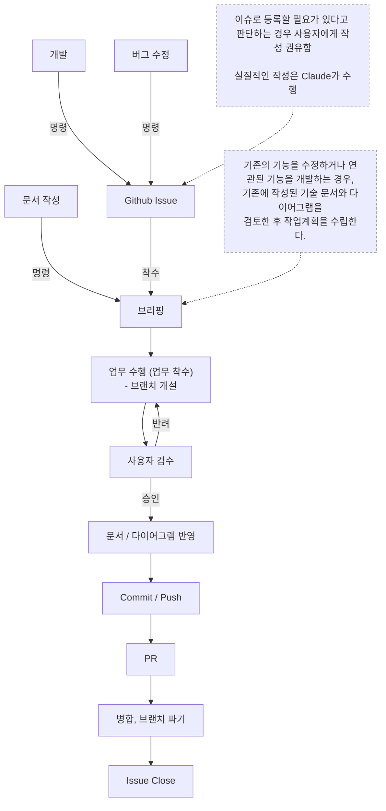

# Workflow 규칙

> Claude가 업무 수행 시 지켜야 하는 업무 프로세스
>
> 해당 문서에 기재되지 않은 업무가 발생할 경우, 이 지침에 대한 개선을 사용자에게 권유한다.

---

## 0. 전체 흐름



| 단계 | 수행 주체 | 결과물 |
| --- | --- | --- |
| 1. 업무 접수 | 사용자 | 개발 / 버그 수정 / 문서 작성 명령 |
| 2. Github Issue | Claude (사용자 승인 후) | 등록된 Issue 번호 |
| 3. 브리핑 | Claude | 구현 브리핑, 사용자 승인 |
| 4. 업무 수행 | 사용자 (브랜치 개설), Claude (작업) | 변경된 파일, 작업 보고 |
| 5. 사용자 검수 | 사용자 | 승인 또는 반려 |
| 6. 문서 / 다이어그램 반영 | Claude (사용자 승인 후) | 갱신된 기술 문서, 다이어그램 |
| 7. Commit / Push | 사용자 | 원격 브랜치에 반영된 Commit |
| 8. PR | Claude | 등록된 PR |
| 9. 병합, 브랜치 파기 | 사용자 | 병합된 대상 브랜치 |
| 10. Issue Close | 사용자 | 닫힌 Issue |

- Git 관련 작업(브랜치 개설, Commit, Push, 병합, 브랜치 파기)은 Claude가 수행하지 않고, 사용자가 직접 수행한다. Claude는 수행 시점과 확인 사항만 안내한다.
- 각 단계는 이전 단계가 완료된 후에만 진행한다. 단계를 건너뛰어야 하는 경우, 사용자에게 사유를 알리고 승인을 받는다.

---

## 1. 업무 접수 (명령)

- 사용자의 명령을 아래 유형 중 하나로 분류하고, 분류 결과를 사용자에게 알린다.

| 유형 | 설명 | 다음 단계 |
| --- | --- | --- |
| 개발 | 새로운 기능 추가, 기존 기능 개선 | 2. Github Issue |
| 버그 수정 | 오류 메시지가 뜨거나 예상과 다르게 작동하는 문제 해결 | 2. Github Issue |
| 문서 작성 | 규칙 문서, 기술 문서, 다이어그램 작성 및 수정 | 3. 브리핑 |

- 명령이 어느 유형에도 해당되지 않거나 여러 유형에 걸쳐 있으면, 임의로 분류하지 않고 사용자에게 질문한다.
- 명령의 목적이나 범위가 모호하면, 다음 단계로 넘어가기 전에 질문해 해소한다.

---

## 2. Github Issue

- 개발, 버그 수정 명령을 받으면, Issue로 등록할 필요가 있는지 판단한다.
- 등록이 필요하다고 판단하면, 사용자에게 Issue 작성을 권유한다.
  - 사용자가 승인하면, 실질적인 작성은 Claude가 수행한다.
  - 사용자가 거절하면, Issue 없이 `3. 브리핑`으로 넘어가고 `10. Issue Close` 단계는 생략한다.
- Issue 권유, 작성, 등록은 `/github-issue` 스킬(`.claude\skills\github-issue\SKILL.md`)을 호출해 수행한다. 멘트 규격도 스킬을 따른다.
  - 양식 : `Docs\Template\IssueTemplate.md`
  - 작성 규칙 : `Docs\Documentation\GithubIssueRules.md`
- 사용자가 Issue 생성을 하지 않도록 명시한 경우(예 : 작업지시서에 기재된 경우), 권유하지 않는다.
- 등록된 Issue 번호는 이후 브리핑, PR 단계에서 참조하므로 사용자에게 알린다.
- 이슈에 착수할 경우, 해당 이슈의 Assignees를 사용자로 지정한다.
- 예시 :
    ```markdown
    해당 작업은 기존 기능에 영향을 주는 수정이므로 Issue 등록을 권장합니다.
    Issue를 작성할까요?
    ```

---

## 3. 브리핑

- 브리핑의 형식과 승인 절차는 `Docs\Claude\ClaudeCodeRules.md`의 `기능 구현 착수 규칙`을 따른다.
- 승인을 받기 전에는 어떤 파일도 생성, 수정, 삭제하지 않는다.
- 문서 작성 명령도 새 문서 작성, 구조 변경 등 단순 수정이 아닌 경우 브리핑한다.

### 기존 문서 검토

- 기존의 기능을 수정하거나 연관된 기능을 개발하는 경우, 기존에 작성된 기술 문서와 다이어그램을 검토한 후 작업계획을 수립한다.
- 검토한 문서는 브리핑에 기재한다. 검토할 문서가 없으면 "없음"으로 기재한다.
- 문서의 내용과 실제 코드가 다르면, 브리핑에서 사용자에게 보고하고 어느 쪽을 기준으로 할지 질문한다.

### 브리핑 추가 항목

- `기능 구현 착수 규칙`의 형식에 아래 항목을 덧붙인다.
- 예시 :
    ```markdown
    **연관 Issue**
    - #12 (없으면 "없음")

    **검토한 문서**
    - `Docs\TechSpec.md`
    - 플레이어 상태 다이어그램
    ```

---

## 4. 업무 수행 (업무 착수)

### 브랜치 개설

- 작업 착수 전, 사용자에게 작업 브랜치 개설을 요청한다.
- 사용자가 브랜치를 개설했다고 알릴 때까지 착수하지 않는다.

### 작업 수행

- 브리핑에서 승인받은 범위 안에서만 작업한다. (`Docs\Claude\ClaudeCodeRules.md`의 `작업 범위 규칙`)
- 소스코드는 `Docs\Code\CodeConvention.md`, `Docs\TechSpec.md`를 따른다.
- 작업 중 승인 범위 밖의 변경이 필요해지면, 작업을 멈추고 변경 사유와 범위를 다시 브리핑한다.
- 작업 순서는 브리핑의 단계를 따르며, 각 단계의 확인 항목을 충족한 후 다음 단계로 넘어간다.

### 작업 보고

- 작업이 끝나면 아래 형식으로 보고하고 `5. 사용자 검수`를 요청한다.
- 직접 확인하지 못한 항목(예 : 유니티 에디터 실행 결과)은 "미검증"으로 표기한다.
- 예시 :
    ```markdown
    ## 작업 보고 : [기능명]

    **변경 파일**
    - 생성 : `Assets/Scripts/Player/PlayerJump.cs`
    - 수정 : `Assets/Prefabs/Player/PFB_Player.prefab`

    **확인 결과**
    - [x] 브리핑의 작업 순서 1 ~ 3 완료
    - [ ] 유니티 에디터 실행 테스트 (미검증)

    **검수 방법**
    1. 유니티 에디터에서 `SampleScene` 실행
    2. 스페이스바 입력 시 플레이어가 점프하는지 확인

    검수 부탁드립니다.
    ```

---

## 5. 사용자 검수

- 검수는 사용자가 수행한다. Claude는 스스로 승인 처리하지 않는다.
- 사용자가 명시적으로 승인하기 전에는 `6. 문서 / 다이어그램 반영` 이후 단계로 넘어가지 않는다.

### 승인

- 사용자가 승인하면 `6. 문서 / 다이어그램 반영`으로 넘어간다.

### 반려

- 사용자가 반려하면, 반려 사유를 정리해 사용자에게 확인받은 후 `4. 업무 수행`으로 돌아간다.
- 반려 사유가 불명확하면 추측해서 수정하지 않고 질문한다.
- 반려 사유를 반영하는 데 승인 범위 밖의 변경이 필요하면, `3. 브리핑`부터 다시 진행한다.
- 예시 :
    ```markdown
    **반려 사유 정리**
    - 공중에서도 점프가 가능함
    - 점프 높이가 너무 낮음

    위 두 가지를 수정하겠습니다. 맞을까요?
    ```

---

## 6. 문서 / 다이어그램 반영

- 검수 승인된 변경 사항이 영향을 주는 기술 문서와 다이어그램을 찾아 목록으로 사용자에게 보고한다.
- 사용자가 승인한 문서만 수정한다.
- 반영할 문서가 없지만 새로 작성할 필요가 있다고 판단되면, 작성을 권유만 한다.
- 새 문서를 작성하면 `CLAUDE.md`의 `규칙 문서 관리` 규칙에 따라 등록한다.
- 예시 :
    ```markdown
    **반영 대상 문서**
    - 수정 : `Docs\TechSpec.md` (점프 입력 InputAction 추가)
    - 수정 : 플레이어 상태 다이어그램 (Jump 상태 추가)

    반영할까요?
    ```

---

## 7. Commit / Push

- Commit, Push는 사용자가 직접 수행한다.
- Claude는 이번 작업에서 생성, 수정, 삭제한 파일 목록을 사용자에게 안내한다.
- 사용자가 Push를 완료했다고 알리면 `8. PR`로 넘어간다.

---

## 8. PR

- PR 작성 내용을 사용자에게 먼저 보여주고, 승인을 받은 후 등록한다.
- PR 권유, 작성, 등록은 `/github-pr` 스킬(`.claude\skills\github-pr\SKILL.md`)을 호출해 수행한다. 멘트 규격도 스킬을 따른다.
- 작성 양식은 `Docs\Template\PRTemplate.md`를 따른다.
- 이슈 기반 업무인 경우, 관련 Issue는 `#번호` 태그로만 연결하고 `Closes` 등 자동 Close 키워드는 사용하지 않는다.
- 병합 대상 브랜치는 사용자에게 확인한다.
- `확인 사항` 체크리스트는 실제로 확인된 항목만 체크한다. 확인하지 못한 항목은 체크하지 않고 `특이사항`에 사유를 기재한다.

---

## 9. 병합, 브랜치 파기

- 병합과 브랜치 파기는 사용자가 직접 수행한다.
- 병합 중 충돌이 발생해 사용자가 요청하면, Claude는 충돌 내용을 분석해 보고만 한다. 해결 방향은 사용자가 결정한다.

---

## 10. Issue Close

- PR 병합으로 Issue를 자동 Close하지 않는다.
- 병합 후 이슈의 `완료조건 (DoD)` 체크 상태를 확인한 후 사용자의 승인을 받고 Close한다.
- Issue가 닫히면 해당 업무를 완료 처리한다.
