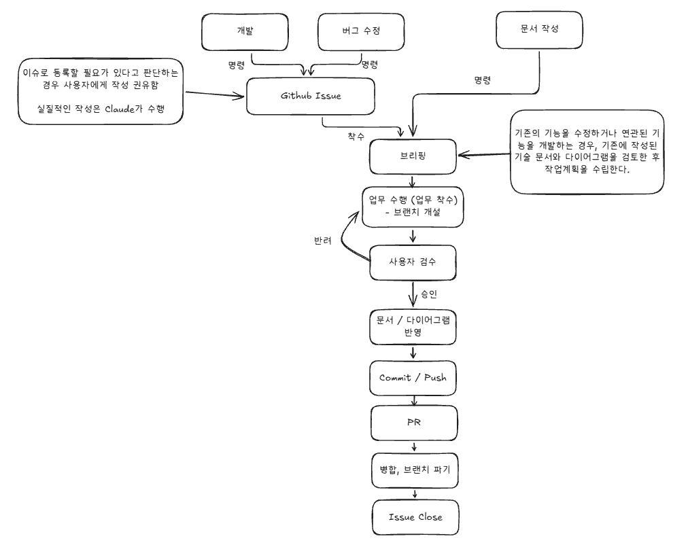

# 작업 지시서

> 작업이 완료되었음을 사용자를 통해 승인받을 경우, 이 문서를 삭제한다.
>
> 기존 파일의 수정/삭제가 필요한 경우, 반드시 사용자의 승인 하에 수행한다.

---

## 작업 목적

- WorkflowRules 전체 흐름도 변경

## 작업 내용

- `Docs\Claude\WorkflowRules.md`의 전체 흐름에서 노트 2개를 추가한다.
- 
- `image.png`에서 Github Issue의 좌측 노드, 브리핑의 우측 노드를 노트로 추가한다.

## 참고 자료

- Workflow Rules : `Docs\Claude\WorkflowRules.md`